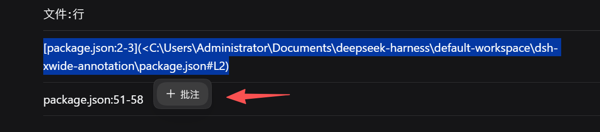
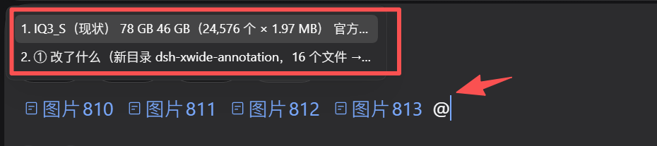
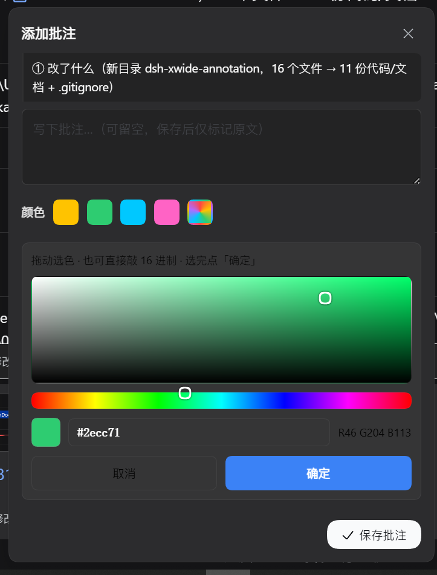
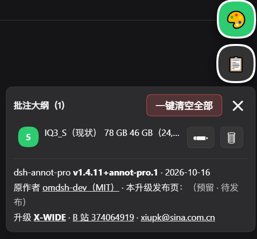
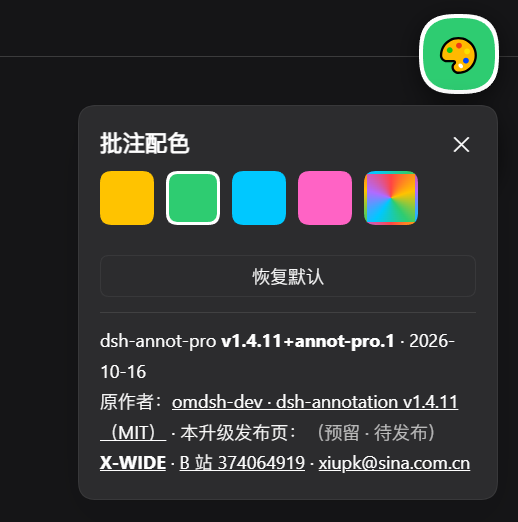

# 使用说明 · dsh-xwide-annotation

> 面向使用者的操作手册。安装步骤见 [README.zh-CN.md](../README.zh-CN.md#安装官方-bundle-路径--唯一)；这里是**装好之后怎么用**。
> 适用版本：**v1.5.0**（X-WIDE 衍生版，基于上游 `@changfenhuang/dsh-annotation` v1.4.11，MIT）。

---

## 1. 三分钟上手

| 步 | 做什么 | 看到什么 |
|---|---|---|
| ① | 在助手回复里**用鼠标选中一段文字** | 选区旁浮出工具条，里面有「**+ 批注**」按钮 |
| ② | 点「+ 批注」→ 弹出「添加批注」卡片 → 写下你的问题（**可以留空**＝只标记原文）→ 点「✓ 保存批注」 | 原文处出现**彩色编号徽标 + 高亮** |
| ③ | 想问几段就重复①②几次，然后**在输入框敲回车** | 批注块随你的问题一起发给模型；模型按「Annotation 1：… Annotation 2：…」逐条回答 |



**发送前确认清单**（输入框上方，可逐条看内容）：



**添加批注卡片 + 自定义取色盘**：



> 你的**消息气泡里不会出现批注正文**——只显示你的问题 + 「批注 ×N」标签（悬浮可看全部内容、可单条删除）。模型回复里的每个 `Annotation N` 都是**可悬浮芯片**，hover 显示对应的原文与批注。

---

## 2. 界面地图

| 位置 | 名称 | 作用 |
|---|---|---|
| 选区旁 | **+ 批注** | 新建一条批注（见 §1） |
| 右下角小圆点 🎨 | **批注配色**（配色工作室） | 选高亮颜色；可**拖动**到任意位置；快捷键 `Alt`+`Shift`+`C` 循环预设 |
| 剪贴板图标 📋 | **批注大纲** | 打开大纲面板，列出当前对话全部批注 |
| 输入框上方 | **批注 ×N** 标签 | 本次待发批注的清单，hover 看内容 / 删单条 |
| 页面角标 | **● 自检** | 自检角标（见 §6） |

---

## 3. 批注大纲（📋 按钮）



- **标题「批注大纲（N）」** = 当前对话的批注条数。
- 每条前面是**编号徽标**，颜色按序号轮换（1 黄 / 2 红 / 3 绿…），与正文里的徽标颜色一致。
- **点一条 → 跳到该标记的位置并高亮**（Obsidian 式跳转）。
- 每条右侧两个小按钮：**✏ 改批注**、**🗑 清除这条**（本地隐藏，**不改历史消息**）。
- **「一键清空全部」= 二次确认**：会先弹「⚠️ 确定清空全部 N 条批注吗？清空后大纲里就不再显示，且不可撤销。」——确认后**不可撤销**。
- **按会话隔离**（v1.5.0 修复）：在 A 对话清空，不会影响 B 对话里的同名文字批注。

> 截图页脚显示 `dsh-annot-pro v1.4.11+annot-pro.1` 是**本机旧版界面**；发布版 v1.5.0 的页脚已改为 `dsh-xwide-annotation v1.5.0` 并指向本仓库。

---

## 4. 配色工作室（🎨 小圆点）



| 预设 | 色值 |
|---|---|
| 荧光黄 | `#ffc300` |
| 荧光绿 | `#2ecc71` |
| 荧光青 | `#00c8ff` |
| 荧光粉 | `#ff63c5` |

- 第 5 个**彩虹块** = 展开自定义取色盘：可拖动选色，也可**直接敲 16 进制**（如 `#2ecc71`，旁边实时显示 R/G/B），选完点「**确定**」（点「取消」则不生效）。
- **恢复默认** = 回到内置配色。
- `Alt`+`Shift`+`C` = 在预设之间循环切换，不用开面板。
- 小圆点**可以按住拖到任意位置**，位置会记住（`localStorage['dshap.pos.v2']`）。
- 配色选择存在浏览器本地（`localStorage['dshap.color']`）：**换浏览器 / 换电脑不会带过去**。

---

## 5. 侧边栏文件批注

在工作区文件的预览里（Markdown / 代码正文）选中文本，走同一套批注 → 保存 → 回车发送流程；发给模型的引用里**带文件路径**。刷新后重新打开原文件可恢复标记，同文不同文件互不干扰。

**当前不支持**：PDF、图片、iframe 内的 HTML。

---

## 6. 自检角标（不用开发者工具）

页面角落的角标：**绿色「● 自检 OK」** / **红色「● 自检 N 问题」**。

- **单击** = 重新自检 + 展开/收起明细；**双击** = 本次隐藏（刷新后回来）；按住可拖动；「×」收起成小圆点。
- **安静模式**：自检**没问题时完全不露面**，不占地方、不挡操作。
- 明细里能看到自检时间、页面 URL、以及内部计数（如 `itemColors`、`hiddenKeys`），历史自检记录存在 `localStorage['dshap.telemetry']`。

插件是否装载成功，也可用开发者工具一行确认：

```js
window.__DSH_BOOT__.entries.find(e => e.id === 'dsh-xwide-annotation')
```

---

## 7. 数据与隐私

全部数据只存在**你自己浏览器的 localStorage**，插件**不上传任何内容到服务器**（自检遥测也是本地键）。

| localStorage 键 | 存什么 |
|---|---|
| `dshap.color` | 配色工作室选中的颜色 |
| `dshap.pos.v2` | 小圆点位置 |
| `dshap.mode` | 显示模式开关 |
| `dshap.itemColors` | 每条批注的自定义颜色 |
| `dshap.hidden` | 已从大纲删除的编号/高亮（刷新后不复活） |
| `dshap.telemetry` | 自检历史记录 |
| `dsh.sessions.current` | 当前会话标识（用于按会话隔离清空） |

想彻底清干净：在浏览器 DevTools → Application → Local Storage 删掉以上 `dshap.*` 键，刷新页面即可。

---

## 8. 常见问题

| 现象 | 处理 |
|---|---|
| 选中文字不出「+ 批注」 | 先确认插件已装载（§6 那行命令）；再刷新页面 |
| 大纲是空的，但正文里有标记 | 升级到 v1.5.0（修复了大纲按原文去重导致的条目丢失） |
| 标记画不出来 / 位置漂了 | v1.5.0 引入**行级锚点**（按行定位而非纯字符偏移）；若仍异常，看红色自检角标明细 |
| 在 A 对话清空，把 B 对话的批注也清了 | v1.5.0 已修：清空按会话隔离 |
| 换浏览器颜色/圆点位置没了 | 正常：这些存在本机 localStorage，不跨设备同步 |
| 想临时不显示自检角标 | 双击角标（本次隐藏，刷新回来） |
| 卸载 | `dsh plugin --profile web remove dsh-xwide-annotation` |

---

## 9. 快捷键一览

| 键 | 作用 |
|---|---|
| `Esc` | 收起当前卡片 / 面板 |
| `Alt` + `Shift` + `C` | 循环切换高亮预设色 |
| `Enter` | 把「问题 + 全部批注」一起发出 |
| `Ctrl`/`Cmd` + 点击 | 在已附加批注的状态下附加并发送（输入框非空时） |

---

## 10. 这个版本比上游多了什么

| 项 | 说明 |
|---|---|
| 配色工作室 | 4 套荧光预设 + 自定义取色盘 + `Alt+Shift+C` + 小圆点可拖动 + 本地持久化 |
| 批注大纲 | 列出全部批注、编号按序配色、点击跳转高亮、条目级 ✏改 / 🗑删 |
| 一键清空全部 | 二次确认 + **按会话隔离**（v1.5.0） |
| 大纲去重 | 同原文重复标记不再吞掉条目（v1.5.0） |
| 行级锚点 | 标记位置改为按行定位，遥测从 `items=4 / hl=0` 变为 `hl=20`（v1.5.0） |
| 自检角标 | 绿色 OK / 红色 N 问题，单击重跑并展开明细，安静模式 |

上游原作者与 MIT 条款见 [LICENSE](../LICENSE)；完整变更历史见 [CHANGELOG.md](../CHANGELOG.md)。
